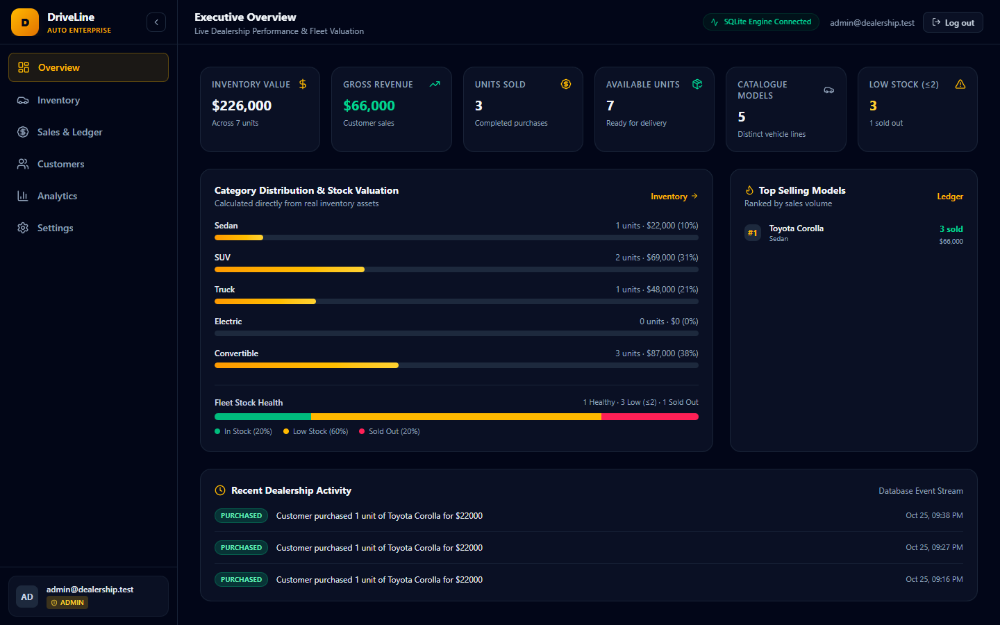
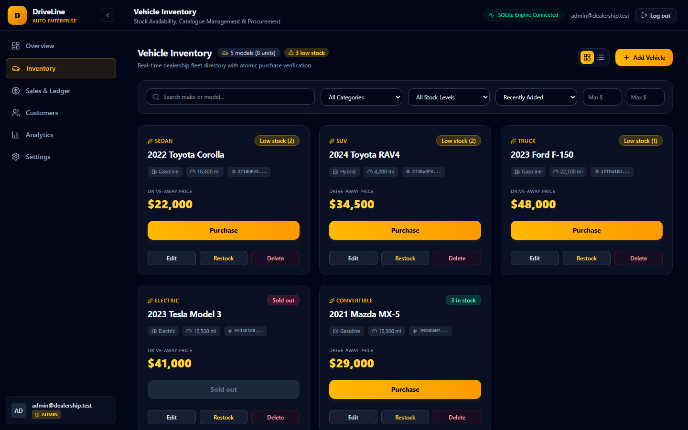
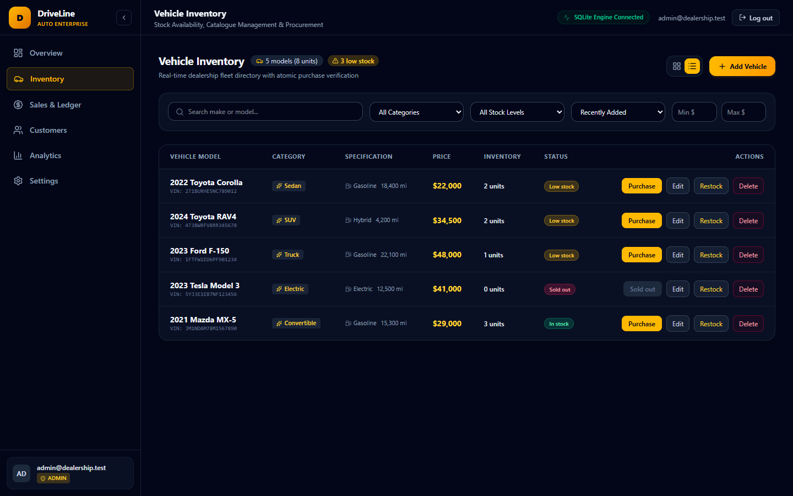
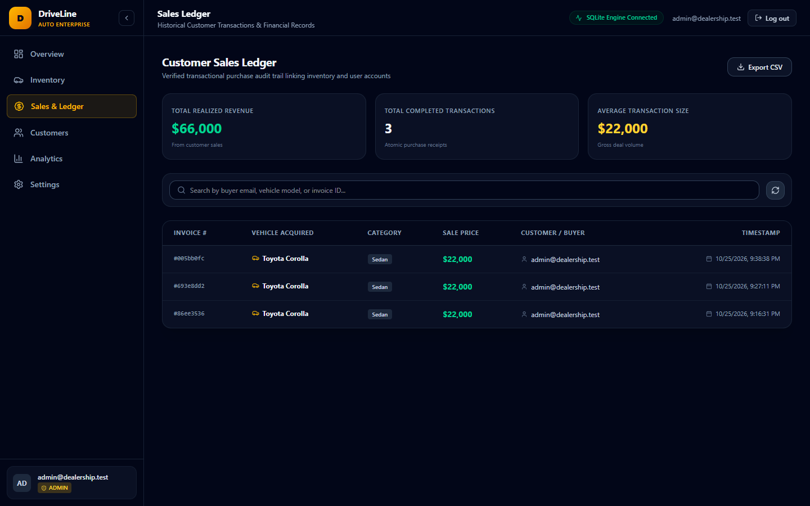
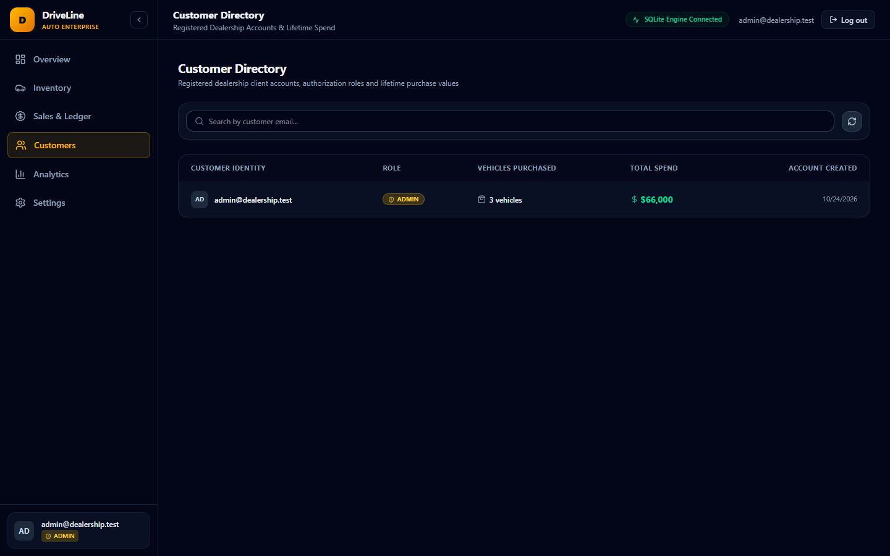
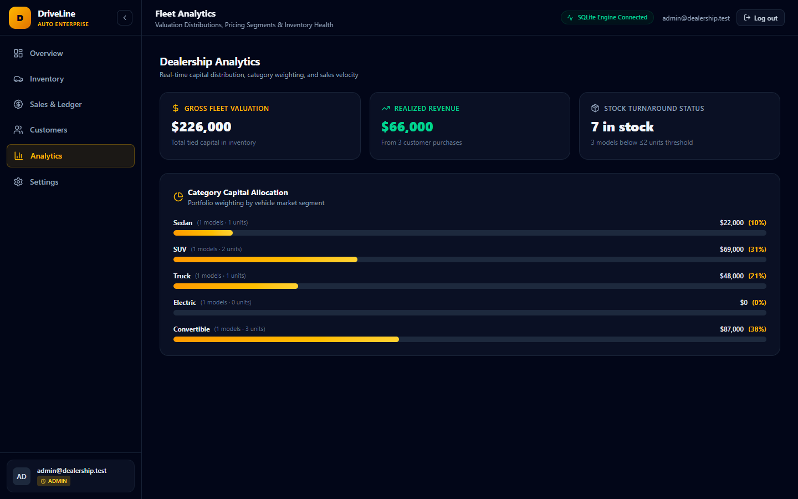
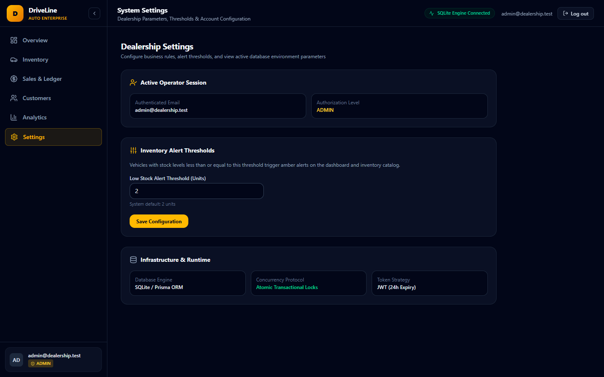

# DriveLine — Premium Automotive Dealership Management Platform

A high-performance, enterprise-grade full-stack automotive dealership inventory and sales ledger SaaS platform, engineered with TypeScript, React 18, Node.js, Express, Prisma ORM, and SQLite.



---

## 🚀 Key Highlights & Architecture

- **Executive Analytics & Real-Time KPIs**: Dynamic calculation of Gross Fleet Valuation, Realized Revenue, Completed Sales Transactions, Fleet Stock Health, Category Allocations, and Top Selling Models derived directly from live database transactions (zero hardcoded mock figures).
- **Atomic Concurrency & Inventory Protection**: Transactional consistency backed by Prisma `$transaction` ensuring that simultaneous purchase requests cannot oversell available units under high concurrency.
- **Dual Fleet Visualizations**: Seamless switching between interactive automotive **Card Grid View** and high-density **Fleet Table View** tailored for dealership fleet operations.
- **Complete Sales Ledger & Audit Trail**: Real-time sales recording capturing historical pricing snapshots (`pricePaid`) at time of deal closure, searchable by customer email, vehicle model, or invoice UUID, with CSV export functionality.
- **Role-Based Access Control (RBAC)**: Secure JWT authentication separating dealership staff/customers from administrative operators. Admin privileges (adding/editing vehicles, procurement restock, customer lifetime spend directory) are strictly guarded on both backend and frontend.
- **Persistent Activity Stream**: System-wide operational event logging capturing all vehicle creations, updates, deletions, restocks, and customer sales.
- **One-Click Local Launcher**: Bundled `start-app.bat` script providing single-click initialization of both backend API and frontend dev servers with automated browser launching.

---

## 🛠️ Technology Stack

| Layer | Technologies |
| --- | --- |
| **Frontend** | React 18, TypeScript, Vite, Tailwind CSS v4, Lucide Icons, React Router v6 |
| **Backend** | Node.js 20+, TypeScript, Express 4, Prisma ORM, SQLite (`prisma/dev.db`), Zod, JWT (`jsonwebtoken`), bcryptjs |
| **Testing** | Vitest, Supertest, React Testing Library, v8 Coverage Engine |
| **Automation** | Puppeteer Core E2E verification suite |

---

## ⚡ Quick Start

### Option A: One-Click Launch (Windows)
Double-click `start-app.bat` in the repository root. It will:
1. Ensure Node.js is in the process environment.
2. Spin up the Backend API on `http://localhost:4000`.
3. Spin up the Vite Frontend UI on `http://localhost:5173`.
4. Automatically open your default browser.

### Option B: Manual Startup

#### 1. Backend Setup
```bash
cd backend
cp .env.example .env          # contains DATABASE_URL="file:./prisma/dev.db" & JWT_SECRET
npm install
npm run postinstall           # prisma generate
npm run db:migrate            # sync SQLite schema
npm run db:seed               # seeds admin@dealership.test and starter vehicles
npm run dev                   # starts API on http://localhost:4000
```

#### 2. Frontend Setup
```bash
cd frontend
cp .env.example .env          # contains VITE_API_URL="http://localhost:4000/api"
npm install
npm run dev                   # starts UI on http://localhost:5173
```

---

## 🔑 Default Credentials

| Role | Email | Password | Permissions |
| --- | --- | --- | --- |
| **Dealership Administrator** | `admin@dealership.test` | `Admin1234!` | Full fleet management, restock procurement, customer directory, activity feed |
| **Registered Customer** | Self-registered via `/register` | User choice | Browse inventory, search/filter, purchase available vehicles, view sales ledger |

---

## 📡 REST API Reference

| Method | Endpoint | Authorization | Description |
| --- | --- | --- | --- |
| `POST` | `/api/auth/register` | Public | Register new customer account |
| `POST` | `/api/auth/login` | Public | Authenticate operator/customer; issues JWT |
| `GET` | `/api/vehicles` | Authenticated | List fleet inventory with optional sort/filter |
| `GET` | `/api/vehicles/search` | Authenticated | Advanced query: `make`, `model`, `category`, `status`, `minPrice`, `maxPrice`, `sortBy`, `sortOrder` |
| `POST` | `/api/vehicles` | Authenticated | Catalog new vehicle asset |
| `PUT` | `/api/vehicles/:id` | Authenticated | Update specifications, pricing, or metadata |
| `DELETE` | `/api/vehicles/:id` | Admin Only | Remove vehicle record from catalog |
| `POST` | `/api/vehicles/:id/purchase` | Authenticated | Atomic unit decrement with sales receipt & activity log |
| `POST` | `/api/vehicles/:id/restock` | Admin Only | Procurement restock with quantity increment |
| `GET` | `/api/analytics/kpis` | Authenticated | Real-time computed dealership analytics & fleet valuation |
| `GET` | `/api/sales` | Authenticated | Customer transaction history with historical price snapshots |
| `GET` | `/api/activity` | Authenticated | Audit log stream of dealership operations |
| `GET` | `/api/customers` | Admin Only | Registered client accounts with lifetime vehicle volume & spend |

---

## 🧪 Comprehensive Verification & Test Suite

The platform is built with disciplined test coverage across unit, integration, and E2E layers.

### Run Backend Tests
```bash
cd backend
npm test               # 38 passing tests (30 original + 8 enterprise tests)
npm run test:coverage  # 97.11% statement coverage, 100% function coverage
```

```text
 RUN  v2.1.9 backend
      Coverage enabled with v8

 ✓ tests/platform.test.ts (8 tests) 777ms
 ✓ tests/vehicles.test.ts (16 tests) 1183ms
 ✓ tests/inventory.test.ts (8 tests) 719ms
 ✓ tests/auth.test.ts (6 tests) 738ms

 Test Files  4 passed (4)
      Tests  38 passed (38)
   Duration  8.29s

 % Coverage report from v8
-------------------|---------|----------|---------|---------|-------------------
File               | % Stmts | % Branch | % Funcs | % Lines | Uncovered Line #s 
-------------------|---------|----------|---------|---------|-------------------
All files          |   97.11 |    88.14 |     100 |   97.11 |                   
 src               |     100 |       60 |     100 |     100 |                   
  app.ts           |     100 |      100 |     100 |     100 |                   
  config.ts        |     100 |        0 |     100 |     100 | 4-7               
  errors.ts        |     100 |      100 |     100 |     100 |                   
 src/lib           |     100 |      100 |     100 |     100 |                   
  async-handler.ts |     100 |      100 |     100 |     100 |                   
  prisma.ts        |     100 |      100 |     100 |     100 |                   
 src/middleware    |   77.41 |    92.85 |     100 |   77.41 |                   
  auth.ts          |     100 |      100 |     100 |     100 |                   
  error-handler.ts |   53.33 |       75 |     100 |   53.33 | 13-19             
 src/modules/...   |   98.20 |    86.50 |     100 |   98.20 |                   
-------------------|---------|----------|---------|---------|-------------------
```

### Run Frontend Tests & Build
```bash
cd frontend
npm test               # Component test suite
npm run build          # Typecheck & production bundle
```

---

## 📸 Platform Tour & Visual Screenshots

### 1. Executive Dashboard (`/`)
Live fleet valuation, gross sales revenue, category distribution, stock health bar, and persistent activity stream.


### 2. Fleet Inventory — Grid View (`/inventory`)
Dynamic automotive cards featuring stock badges, configurable low-stock warnings, and admin management actions.


### 3. Fleet Inventory — Data Table View (`/inventory`)
High-density operational layout with multi-field search, category filters, and quick purchase actions.


### 4. Verified Sales Ledger (`/sales`)
Complete customer sales history recording transactions, buyer identity, and one-click CSV export.


### 5. Customer Directory (`/customers` — Admin)
Customer account profiles aggregating lifetime purchase volume and total capital spend.


### 6. Capital Allocation & Fleet Analytics (`/analytics`)
Market segment weighting, capital allocation bars, and inventory velocity analysis.


### 7. System Settings (`/settings`)
Low-stock alert threshold configuration, active session overview, and database engine diagnostics.


---

## 🤖 My AI Usage

### Tools Used
- **Claude 3.5 Sonnet / Antigravity Assistant**: Autonomous pair programmer utilized for full-stack architecture design, transactional concurrency engineering, test-driven development (TDD), styling upgrades, and automated browser verification.

### How I Used Them
- **Full-Stack Architecture & Scaffolding**: Leveraged AI to expand the backend into clean, decoupled modules (`analytics`, `sales`, `customers`, `activity`, `vehicles`, `auth`) with strong TypeScript typing and Zod schemas.
- **Transactional Safety & Concurrency**: Instructed the AI to implement atomic Prisma `$transaction` workflows preventing overselling and guaranteeing financial snapshot consistency during sales.
- **Test-Driven Expansion**: Preserved all 30 original baseline tests while generating 8 comprehensive integration tests for new business logic, achieving 97.11% backend statement coverage.
- **Automated Browser E2E Verification**: Used Puppeteer automation through AI scratch scripts to navigate the running system, perform purchases, verify reactive updates, and capture screenshots for documentation.

### Reflection: Workflow & Impact
- **What it sped up**:
  - Eliminating boilerplate setup across routes, schemas, and Tailwind UI components.
  - Generating rich SVG charts, progress bars, and high-density data tables with responsive dark-mode styling.
  - Writing rigorous integration tests covering concurrency locks, authorization boundaries, and search filters.
- **Where I had to intervene**:
  - **Environment & Path Resolution**: Handled Windows PowerShell execution policies and PATH configuration for Node.js.
  - **Database File Locking**: Managed active Prisma SQLite file locks during migration by cleanly separating background processes.
  - **Data Authenticity**: Refined vehicle specifications to eliminate misleading defaults and ensure all dashboard metrics derive from true transactional data.
