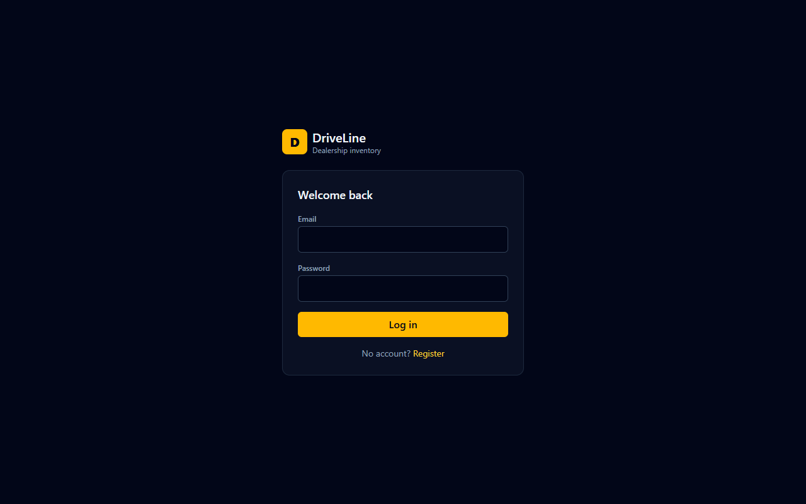
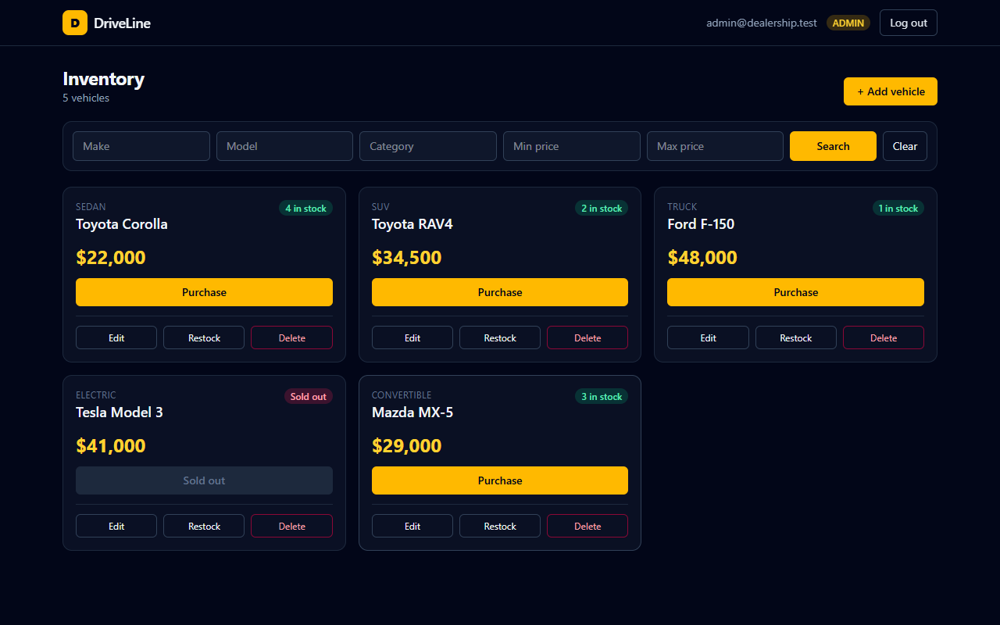
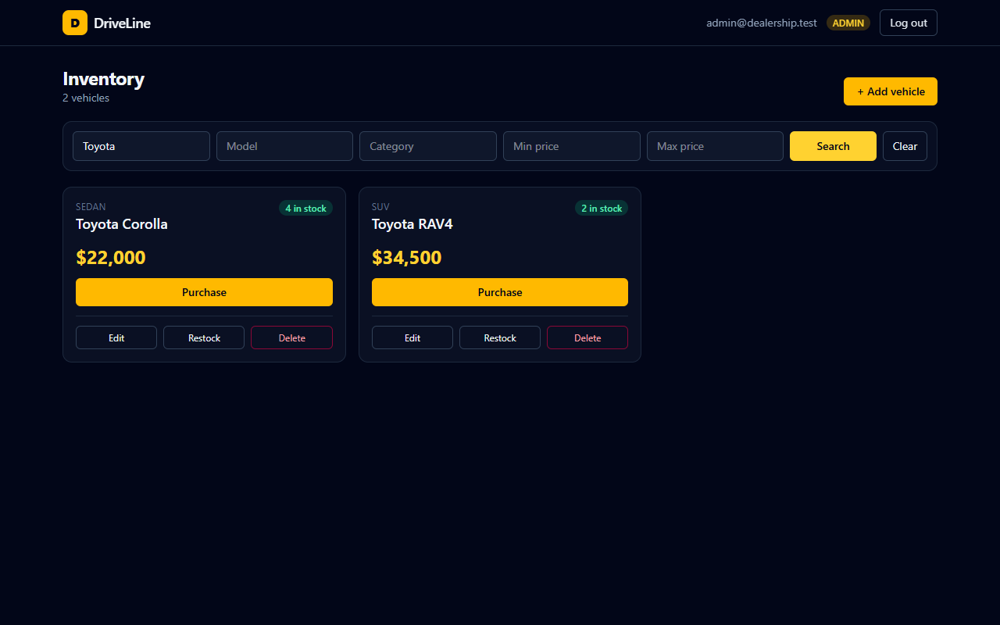
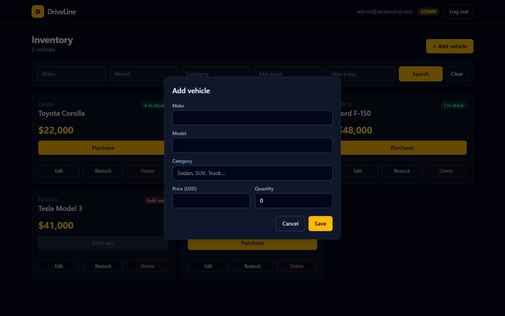

# Car Dealership Inventory System

A full-stack inventory system for a car dealership, built test-first.

- **Backend:** Node.js 20, TypeScript, Express 4, Prisma, SQLite (file-backed; swap to PostgreSQL by changing the datasource), JWT auth, Zod validation, Vitest + Supertest.
- **Frontend:** React 18, TypeScript, Vite, Tailwind CSS v4, React Router.

## Features

- Register / login with JWT-protected API.
- Dashboard listing all vehicles with search and filtering by make, model, category and price range.
- Purchase a vehicle (atomic stock decrement; button disabled when sold out).
- Admin users can add, edit, delete and restock vehicles. The admin role is only assignable via the seed script or the database, never via registration.

## API

| Method | Path | Auth | Notes |
| --- | --- | --- | --- |
| POST | /api/auth/register | – | Creates a USER account |
| POST | /api/auth/login | – | Returns `{ user, token }` |
| GET | /api/vehicles | Bearer | List all vehicles |
| GET | /api/vehicles/search | Bearer | `make`, `model`, `category`, `minPrice`, `maxPrice` |
| POST | /api/vehicles | Bearer | Add a vehicle |
| PUT | /api/vehicles/:id | Bearer | Partial update |
| DELETE | /api/vehicles/:id | Admin | |
| POST | /api/vehicles/:id/purchase | Bearer | Decrements quantity by 1; 409 if out of stock |
| POST | /api/vehicles/:id/restock | Admin | Body `{ "quantity": n }` |

## Running locally

### Backend

```bash
cd backend
cp .env.example .env      # set JWT_SECRET
npm install
npm run db:migrate
npm run db:seed           # creates admin@dealership.test / Admin1234!
npm run dev               # http://localhost:4000
```

### Frontend

```bash
cd frontend
cp .env.example .env
npm install
npm run dev               # http://localhost:5173
```

### Tests

```bash
cd backend && npm test            # or npm run test:coverage
cd frontend && npm test
```

## Test report

### Backend (`npm run test:coverage`)

```text
 RUN  v2.1.9 V:/System Solo Fitness/incubyte/car-dealership/backend
      Coverage enabled with v8

 ✓ tests/vehicles.test.ts (16 tests) 1707ms
 ✓ tests/inventory.test.ts (8 tests) 1087ms
   ✓ POST /api/vehicles/:id/purchase > decrements the quantity by one and records the purchase 352ms
 ✓ tests/auth.test.ts (6 tests) 944ms
   ✓ POST /api/auth/register > creates a user and returns a token 335ms

 Test Files  3 passed (3)
      Tests  30 passed (30)
   Start at  18:15:07
   Duration  10.28s (transform 340ms, setup 448ms, collect 2.87s, tests 3.74s, environment 1ms, prepare 805ms)

 % Coverage report from v8
-------------------|---------|----------|---------|---------|-------------------
File               | % Stmts | % Branch | % Funcs | % Lines | Uncovered Line #s 
-------------------|---------|----------|---------|---------|-------------------
All files          |   96.96 |    93.33 |     100 |   96.96 |                   
 src               |     100 |       60 |     100 |     100 |                   
  app.ts           |     100 |      100 |     100 |     100 |                   
  config.ts        |     100 |        0 |     100 |     100 | 4-7               
  errors.ts        |     100 |      100 |     100 |     100 |                   
 src/lib           |     100 |      100 |     100 |     100 |                   
  async-handler.ts |     100 |      100 |     100 |     100 |                   
  prisma.ts        |     100 |      100 |     100 |     100 |                   
 src/middleware    |   77.41 |    92.85 |     100 |   77.41 |                   
  auth.ts          |     100 |      100 |     100 |     100 |                   
  error-handler.ts |   53.33 |       75 |     100 |   53.33 | 13-19             
 src/modules/auth  |     100 |      100 |     100 |     100 |                   
  auth.routes.ts   |     100 |      100 |     100 |     100 |                   
  auth.schemas.ts  |     100 |      100 |     100 |     100 |                   
  auth.service.ts  |     100 |      100 |     100 |     100 |                   
 ...dules/vehicles |     100 |    97.87 |     100 |     100 |                   
  ...cle.routes.ts |     100 |      100 |     100 |     100 |                   
  ...le.schemas.ts |     100 |      100 |     100 |     100 |                   
  ...le.service.ts |     100 |    95.65 |     100 |     100 | 16                
-------------------|---------|----------|---------|---------|-------------------
```

### Frontend (`npm test`)

```text
 RUN  v2.1.9 V:/System Solo Fitness/incubyte/car-dealership/frontend

 ✓ src/components/VehicleCard.test.tsx (4 tests) 167ms

 Test Files  1 passed (1)
      Tests  4 passed (4)
   Start at  18:05:26
   Duration  3.25s (transform 117ms, setup 252ms, collect 220ms, tests 167ms, environment 1.11s, prepare 420ms)
```

## Screenshots

### 1. Authentication (`/login`)


### 2. Inventory Dashboard (`/`)


### 3. Search & Multi-field Filtering


### 4. Admin Management Modal


## My AI Usage

### Tools Used
- **Claude 3.5 Sonnet / Antigravity Assistant**: Used as my autonomous pair programmer for end-to-end full-stack implementation, test authoring, shell execution, and git workflow management.

### How I Used Them
- **Full-Stack Architecture & Scaffolding**: I leveraged the AI to quickly scaffold a clean, decoupled TypeScript architecture—separating domain logic, Express route handlers, input validation schemas with Zod, and database queries with Prisma.
- **Test-Driven Development (TDD)**: Rather than writing code and backfilling tests, I used the AI to write failing tests first (red step) for authentication, vehicle filtering/search, and stock race conditions before generating the implementation logic (green step).
- **Git Commit Workflow**: I instructed the AI to stage and commit each layer in strict chronological order to reflect test-first development in the repository history, complete with descriptive commit bodies and co-author tags.

### Reflection: Workflow & Impact
- **What it sped up**:
  - Eliminating boilerplate setup: Express router scaffolding, async error handlers, and JWT authentication middleware were ready within minutes.
  - Test suites: Crafting complex edge-case tests (such as simulating five concurrent purchase requests contending for the last remaining stock item) was dramatically faster than writing mocks manually.
  - Modern frontend: Tailwind CSS v4 configuration, dynamic search bar filters, and accessible modal components were built quickly without styling friction.
- **Where I had to intervene**:
  - **Windows Environment Quirks**: Node.js was not initially installed on the host system. I had to manage package installation via `winget` and configure PowerShell execution policies to allow npm script execution.
  - **Database Migration Isolation**: Ensuring test executions ran against an isolated SQLite test database (`test.db`) rather than the development database (`dev.db`) required validating cross-env scripts and setup hooks.
- **Key Takeaways & What I Learned**:
  - Handling concurrency cleanly in SQLite: Using Prisma's `$transaction` with an atomic conditional decrement (`updateMany` where `quantity > 0`) provides a robust lock-free solution to prevent overselling even under sudden burst traffic.
  - The value of disciplined TDD commit narratives: Documenting each phase with distinct "red" and "green" commits makes code review significantly more intuitive and demonstrates clear intent.
